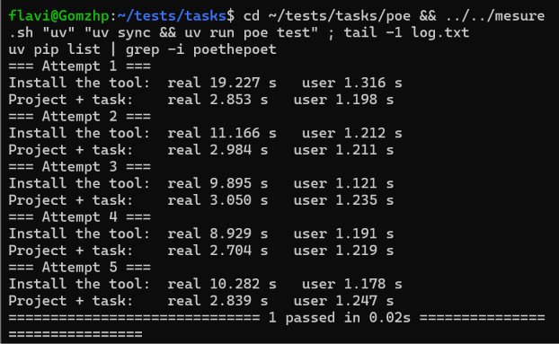
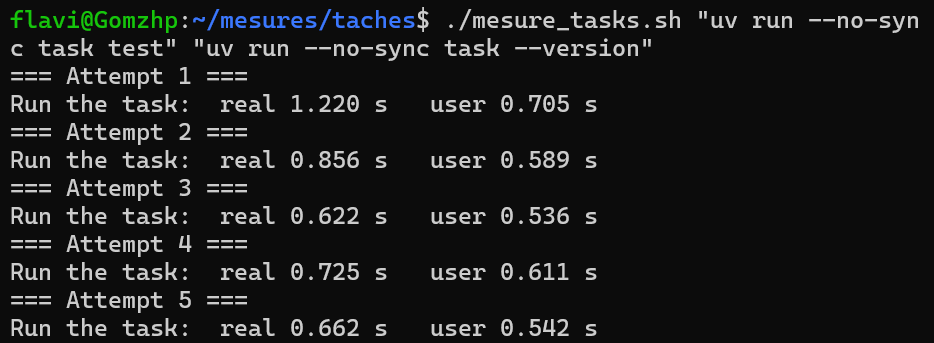
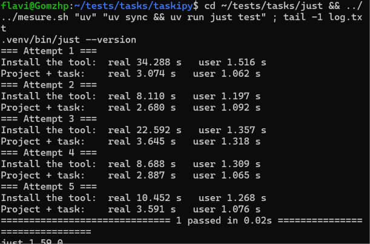
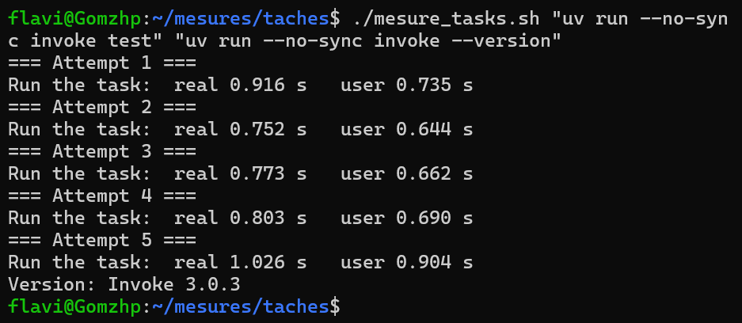
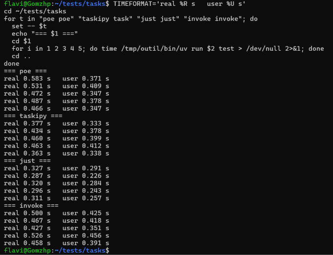

# Choosing a dependency manager and a task manager

## 1. Goal

For my project I need to find a task manager and a dependency manager (Python 3.14).


## 2. The dependency manager

### 2.1 Requirements

The tools I need should follow the Python standards. As the course guide says: "Si hay un estándar, primero hay que conocerlo; a continuación simplemente hay que seguirlo y adaptar el resto de los criterios al mismo."

- The Python standard for describing a project is the `pyproject.toml` file.
- Dependencies go in `[project]` (PEP 621) and development dependencies in `[dependency-groups]` (PEP 735).
	- https://packaging.python.org/en/latest/flow/
	- https://packaging.python.org/en/latest/guides/writing-pyproject-toml/

All the tools that I will use are reproducible, because they all use a lock file (`uv.lock`, `pdm.lock`, `poetry.lock`, Hatch only if locking is enabled).


### 2.2 Criteria

The two criteria that I will measure are the installation time of the tool and the installation time of the project.

These are the most important criteria for my project. According to the course guide, these tools will be used in objectives 5 and 6 (containers and continuous integration), where "installation and execution speed is essential". In those cases, everything is often reinstalled every time.

Also, my code has no dependencies, because it uses `sqlite3` and `csv`, which come with Python. That is why what matters most is the time to install the tool.


### 2.3 Tools studied

I took the list from the official Python guide: https://packaging.python.org/en/latest/tutorials/managing-dependencies/#other-tools-for-application-dependency-management

- Poetry: https://python-poetry.org/docs/
- PDM: https://pdm-project.org/en/latest/
- Hatch: https://hatch.pypa.io/latest/
- uv: https://docs.astral.sh/uv/

### 2.4 Test scenario

For each tool, I measure two times:

1. the time to install the tool, with the command given on its official website:
	- uv: `curl -LsSf https://astral.sh/uv/install.sh | sh`
	- Poetry: `curl -sSL https://install.python-poetry.org | python3 -`
	- PDM: `curl -sSL https://pdm-project.org/install.sh | bash`
	- Hatch: `pip install hatch`
2. the time to install the project:
	- a. create the virtual environment (`.venv`);
	- b. read the dependencies in `pyproject.toml`;
	- c. resolve the versions and write the lockfile (`uv.lock`, `pdm.lock`, `poetry.lock`, `pylock.toml`);
	- d. download and install the packages.

So that the 4 tools do the same work, I told them not to install the project as a package, because it is not one.

For Hatch, I enable locking with `lock-envs = true` in the `[tool.hatch]` section of `pyproject.toml`, so that it also writes a lockfile and the 4 tools do the same work.


Conditions:
- same computer, same network, all 4 tools on the same day;
- WSL (Ubuntu 26.04.1) with Python 3.14.4, because CI and containers will run on Linux;
- each tool starts from a copy of the project with the same `pyproject.toml`;
- each attempt uses a new empty home directory;
- 5 attempts per measurement, I keep the average;
- the `time` command gives two times, and I record both: the real time (`real`) and the tool's computing time (`user`).

#### Script

```bash
#!/bin/bash
export POETRY_VIRTUALENVS_IN_PROJECT=true
export UV_NO_MODIFY_PATH=1
TIMEFORMAT='real %R s   user %U s'

for i in 1 2 3 4 5; do
  echo "=== Attempt $i ==="
  export HOME=$(mktemp -d)
  export PATH=$HOME/.local/bin:/tmp/outil/bin:/usr/local/bin:/usr/bin:/bin
  rm -rf /tmp/outil .venv *.lock pylock*.toml
  /usr/bin/python3 -m venv /tmp/outil

  echo -n "Install the tool:     "
  time bash -c "$1" > /dev/null 2>&1

  echo -n "Install the project:  "
  time bash -c "$2" > log.txt 2>&1
done
```

For example, I use it like this with uv: `./mesure.sh "curl -LsSf https://astral.sh/uv/install.sh | sh" "uv sync"`

### 2.5 Results

Measurements from 25 November 2026, average of 5 attempts.
Each cell shows `real` / `user` time, in seconds.

| Tool | Version | Installation of the tool | Installation of the project |
|---|---|---|---|
| uv |  |  /  |  /  |
| PDM |  |  /  |  /  |
| Poetry |  |  /  |  /  |
| Hatch |  |  /  |  /  |

Screenshots of the measurements:

#### 2.5.1 PDM


#### 2.5.2 Hatch


#### 2.5.3 uv


#### 2.5.4 Poetry


### 2.6 Choice


<! TODO Correct next part !>
## 7. Task tool

A list of different tools can be found here:
- https://scientific-python-cookie.readthedocs.io/en/latest/guides/tasks/
- https://github.com/astral-sh/uv/issues/5903

| Tool | Kept? | Reason |
|---|---|---|
| Poe the Poet | Yes | Python package, installed by uv |
| Taskipy | Yes | Python package, installed by uv |
| just | Yes | On PyPI (`rust-just`), installed by uv |
| Invoke | Yes | Python package, installed by uv |
| uv-tasks | No | Alpha on PyPI, not stable |
| rake | No | For Ruby, not Python |
| make | No | Not a Python package |
| mise | No | Not a Python package |
| nox | No | Runs tasks in its own separate environments, even with uv |
| tox | No | Runs tasks in its own separate environments, even with uv |

### Test

I use the same conditions and script as in part 4. Each task tool is added to the `dev` group with pytest, then I measure `uv sync` and the `test` task.

### Results

Measurements from 18 November 2026, average of 5 attempts. Each cell shows `real` / `user` time, in seconds.

| Tool | Version | Install the project + run the task |
|---|---|---|
| Poe the Poet | 0.49.0 | 2.89 / 1.22 |
| Taskipy | 1.14.1 | 2.80 / 1.15 |
| just | 1.59.0 | 3.18 / 1.12 |
| Invoke | 3.0.3 | 2.67 / 1.22 |

Screenshots of the measurements:

### 7.1 Poe the Poet


### 7.2 Taskipy


### 7.3 just


### 7.4 Invoke


The results are almost the same: the difference is about 0.1 s in `user` time, which is less than the variation between attempts. So I also measure the time to run the `test` task alone, with the project already installed. This matters because the task is run much more often than the installation.

| Tool | Run the task only |
|---|---|
| Poe the Poet | 0.51 / 0.37 |
| Taskipy | 0.42 / 0.37 |
| just | 0.31 / 0.26 |
| Invoke | 0.48 / 0.41 |



## 8. Choice of the task tool

I choose just.

Installing the project takes about the same time with the 4 tools, so this measurement cannot separate them. But just runs the task the fastest: 0.26 s in `user` time, against 0.37 s for Taskipy and Poe the Poet, and 0.41 s for Invoke.

My final choice is uv for dependencies and just for tasks.