# Elección de una herramienta para las dependencias y las tareas

## 1. Objetivo

Busco una herramienta para gestionar las dependencias y las tareas (lint, test...) de mi proyecto en Python 3.14. Tiene que respetar los estándares de Python, para poder cambiar de herramienta más adelante si hace falta.

## 2. Criterios

### Respeto del estándar

- El estándar de Python para describir un proyecto es el fichero `pyproject.toml`.
- Las dependencias van en `[project]` (PEP 621) y las dependencias de desarrollo en `[dependency-groups]` (PEP 735).
	- https://packaging.python.org/en/latest/flow/
	- https://packaging.python.org/en/latest/guides/writing-pyproject-toml/

`requirements.txt` no es un estándar, es solo una convención de pip. Para las tareas no hay estándar, cada herramienta tiene su propia forma de hacerlo.

### Velocidad

Mido el tiempo para instalar la herramienta, y luego el tiempo para instalar el proyecto y lanzar una tarea.

Es el criterio más importante para mi proyecto. Según el guion, estas herramientas se usarán en los objetivos 5 y 6 (contenedores e integración continua), donde «la velocidad de instalación y de ejecución es esencial». En esos casos, a menudo se vuelve a instalar todo cada vez.

Además, mi código casi no tiene dependencias, porque usa `sqlite3` y `csv`, que vienen con Python. Solo las tareas necesitan herramientas como ruff. Por eso, lo que más cuenta es el tiempo para instalar la herramienta y lanzar una tarea.

## 3. Herramientas estudiadas

He sacado la lista de la guía oficial de Python: https://packaging.python.org/en/latest/tutorials/managing-dependencies/#other-tools-for-application-dependency-management

| Herramienta | ¿Se queda? | Motivo | Fuente |
|---|---|---|---|
| pip | No | Instala paquetes, pero no gestiona ni el entorno ni las tareas. | https://pip.pypa.io/en/stable/user_guide/ |
| pip-tools | No | No gestiona ni el entorno ni las tareas, y su lockfile es un `requirements.txt`. | https://pip-tools.pypa.io/en/stable/ |
| Pipenv | No | Usa su propio fichero, el `Pipfile`, que no es un estándar. | https://pipenv.pypa.io/en/latest/pipfile.html |
| Poetry | Sí | Usa `pyproject.toml`. | https://python-poetry.org/docs/pyproject/ |
| PDM | Sí | Usa `pyproject.toml`. | https://pdm-project.org/latest/usage/dependency/ |
| Hatch | Sí | Usa `pyproject.toml`. | https://hatch.pypa.io/latest/config/environment/overview/ |
| uv | Sí | Usa `pyproject.toml`. | https://docs.astral.sh/uv/concepts/projects/dependencies/ |

PDM y Hatch también saben lanzar tareas. uv y Poetry no, así que he añadido Poe the Poet para ellos (https://poethepoet.natn.io/).

Lo he elegido en lugar de un Taskfile o un Makefile porque se instala con pip como las demás herramientas, sus tareas también van en `pyproject.toml`, y funciona con uv y con Poetry.

## 4. Escenario de prueba

Para cada herramienta, mido dos tiempos:
1. el tiempo para instalar la herramienta con `pip install`;
2. el tiempo para instalar el proyecto (con ruff) y lanzar la tarea `lint`, que ejecuta `ruff check .`.

Condiciones:
- mismo ordenador, misma red, las 4 herramientas el mismo día;
- WSL (Ubuntu 26.04.1) con Python 3.14.4, porque la CI y los contenedores funcionarán en Linux;
- cada herramienta parte de una copia del proyecto con el mismo `pyproject.toml`;
- vacío las cachés antes de cada intento, así que los tiempos incluyen las descargas;
- 3 intentos por medición, me quedo con la media;
- el comando `time` da dos tiempos, y apunto los dos: el tiempo real (`real`) y el tiempo de cálculo de la herramienta (`user`).

Para que las 4 herramientas hagan el mismo trabajo, les he indicado que no instalen el proyecto como un paquete, porque no lo es. Con uv y Poetry, también he tenido que indicar a Poe dónde encontrar ruff.

## 5. Resultados

Mediciones del 10 de noviembre de 2026, media de 3 intentos.

| Herramienta | Versión | Instalar la herramienta (s) | Lanzar la tarea (s) | Total (s) |
| --------------------- | --------------- | --------------------- | ------------------- | --------- |
| PDM | 2.29.7 | 35.05 | 23.82 | 58.87 |
| Hatch | 1.18.2 | 117.04 | 14.77 | 131.81 |
| uv + Poe the Poet | 0.13.7 + 0.49.0 | 21.10 | 39.66 |60.76 |
| Poetry + Poe the Poet | 2.5.1 + 0.49.0 | 131.29 |  33.11| 164.40 |

La red cambió mucho durante las pruebas. Por ejemplo, la tarea con uv tardó entre 8.8 s y 72.8 s según el intento. El tiempo `user`, en cambio, casi no depende de la red, porque es el tiempo en el que la herramienta calcula de verdad. Como los tiempos reales varían demasiado, me fío sobre todo del tiempo `user` para comparar las herramientas.

| Herramienta           | Instalar la herramienta, `user` (s) | Lanzar la tarea, `user` (s) | Total `user` (s) |
| -------| --------- | ----------- | ----------- |
| PDM    |  10.07     |  10.55     |  20.62       |
|Hatch   |  12.87    |   3.78      |   16.65      |
| uv + Poe the Poet  |   2.86 |   1.80 |    4.66         |
| Poetry + Poe the Poet |   15.54|4.26 |19.80 | 

Capturas de pantalla de las mediciones:

### 5.1 PDM
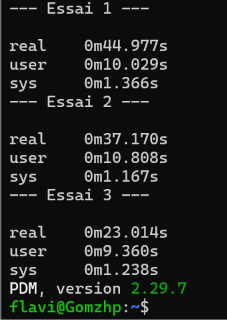
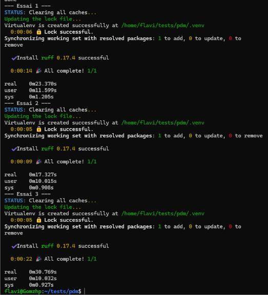

### 5.2 Hatch
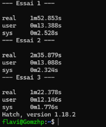
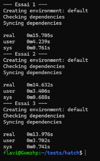

### 5.3 uv + Poe the Poet
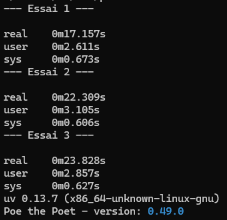
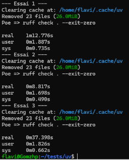

### 5.4 Poetry + Poe the Poet
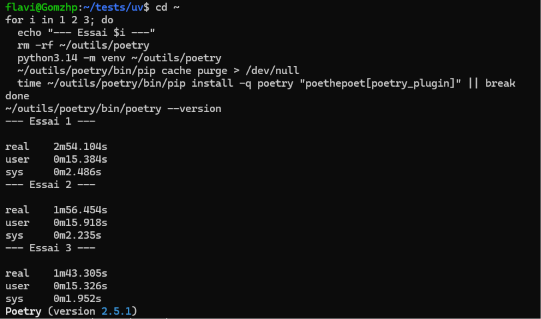
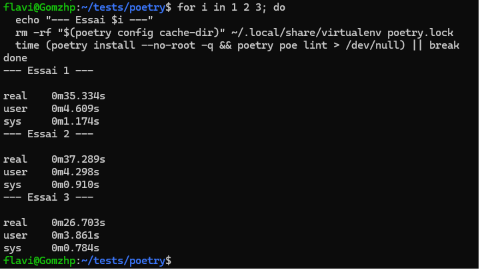

## 6. Elección

Elijo uv con Poe the Poet.

Con el tiempo total, uv + Poe (60.76 s) y PDM (58.87 s) son casi iguales. La diferencia es de 2 s, mientras que la red hizo variar una misma medición entre 8.8 s y 72.8 s según el intento. Por eso no puedo separarlos con este tiempo. Hatch y Poetry son más lentos.

Con el tiempo `user`, uv + Poe es el más rápido: 4.66 s, mientras que los demás están entre 16 y 21 s. Este tiempo casi no depende de la red, así que es mi medición más fiable.

uv + Poe son dos herramientas en lugar de una. Pero incluso siendo dos, se instalan más rápido que PDM solo (21.10 s frente a 35.05 s). Las dos se configuran en `pyproject.toml`, y uv respeta el estándar, así que podré cambiar de herramienta más adelante si hace falta.

## 7. Herramienta de tareas

En la parte 6 elegí Poe the Poet porque fue la primera herramienta de tareas que encontré y porque funcionaba con uv y con Poetry, sin compararla con las demás. 
Aquí la comparo con otras herramientas.

uv no gestiona las tareas por sí solo (https://github.com/astral-sh/uv/issues/5903). En esa discusión se citan Poe the Poet, taskipy, just y doit. He añadido Task, que era otra opción que había considerado.

Make queda fuera: mi prueba mide el tiempo para añadir la herramienta al proyecto con uv, y Make no se puede añadir así porque no es un paquete de Python.

| Herramienta | Paquete | Fuente |
|---|---|---|
| Poe the Poet | `poethepoet` | https://poethepoet.natn.io/ |
| Taskipy | `taskipy` | https://pypi.org/project/taskipy/ |
| just | `rust-just` | https://pypi.org/project/rust-just/ |
| doit | `doit` | https://pydoit.org/ |
| Task | `go-task-bin` | https://taskfile.dev/installation/ |

### Prueba

Mantengo las mismas condiciones que en la parte 4.

Para cada herramienta, mido el tiempo para añadirla al proyecto con uv, vaciando la caché antes de cada intento.

Para las 3 herramientas más rápidas, mido también el tiempo para lanzar la tarea `lint`, que revisa el código con ruff.

### Resultados

Mediciones del 11 de noviembre de 2026, media de 3 intentos.

| Herramienta | Versión | Instalar, `user` (s) | Tarea, `user` (s) | Total `user` (s) |
|---|---|---|---|---|
| just | 1.59.0 | 0.64 | | |
| doit | 0.37.0 | 0.43 | | |
| Poe the Poet | 0.49.0 | 0.61 | | |
| Taskipy | 1.14.1 | 0.64 | | |
| Task | | |  |  |

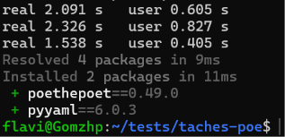
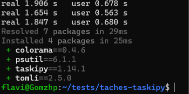
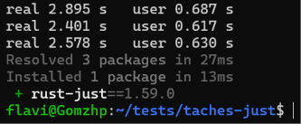
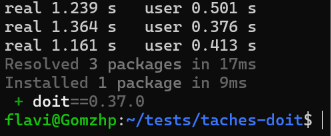
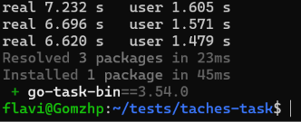