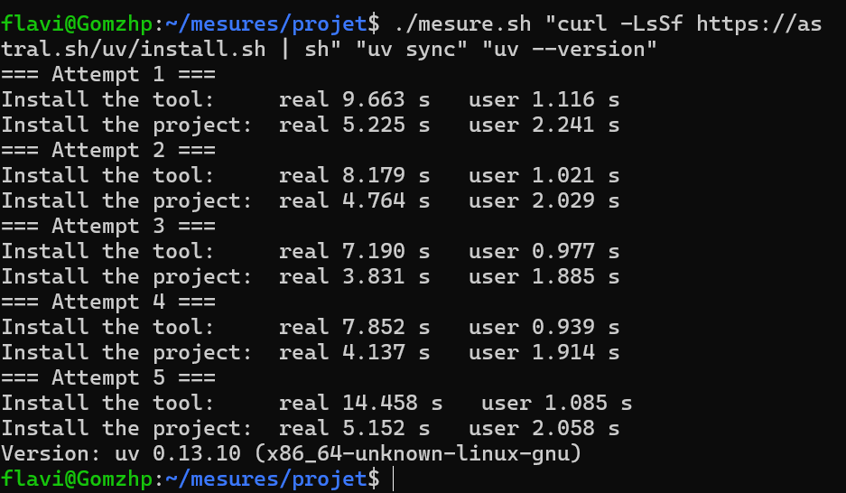
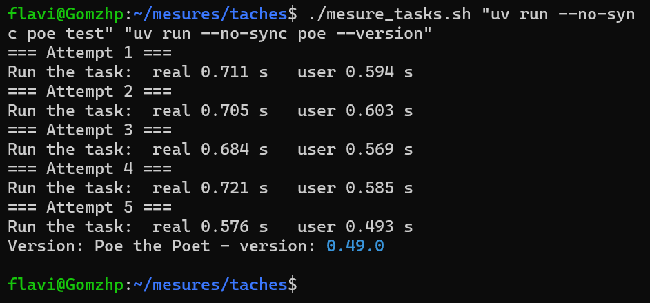
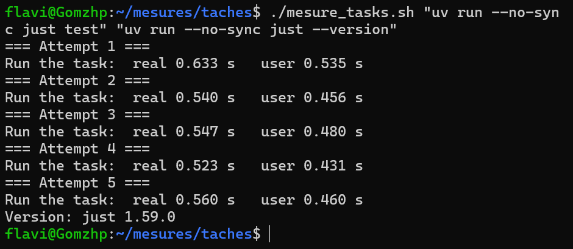

# Choosing a dependency manager and a task manager

## 1. Goal

For my project I need to find a task manager and a dependency manager (Python 3.14).


## 2. The dependency manager

### 2.1 Requirements

The tools I need should follow the Python standards. As the course guide says: "Si hay un estándar, primero hay que conocerlo; a continuación simplemente hay que seguirlo y adaptar el resto de los criterios al mismo."

- The Python standard for describing a project is the `pyproject.toml` file.
- Dependencies go in `[project]` (PEP 621) and development dependencies in `[dependency-groups]` (PEP 735).
	- https://packaging.python.org/en/latest/flow/
	- https://packaging.python.org/en/latest/guides/writing-pyproject-toml/

All the tools that I will use are reproducible, because they all use a lock file (`uv.lock`, `pdm.lock`, `poetry.lock`).


### 2.2 Criteria

The two criteria that I will measure are the installation time of the tool and the installation time of the project.

These are the most important criteria for my project. According to the course guide, these tools will be used in objectives 5 and 6 (containers and continuous integration), where "installation and execution speed is essential". In those cases, everything is often reinstalled every time.

Also, my code has no dependencies, because it uses `sqlite3` and `csv`, which come with Python. That is why what matters most is the time to install the tool.


### 2.3 Tools studied

I took the list from the official Python guide: https://packaging.python.org/en/latest/tutorials/managing-dependencies/#other-tools-for-application-dependency-management

- Poetry: https://python-poetry.org/docs/
- PDM: https://pdm-project.org/en/latest/
- uv: https://docs.astral.sh/uv/

### 2.4 Test scenario

For each tool, I measure two times:

1. the time to install the tool, with the command given on its official website:
	- uv: `curl -LsSf https://astral.sh/uv/install.sh | sh`
	- Poetry: `curl -sSL https://install.python-poetry.org | python3 -`
	- PDM: `curl -sSL https://pdm-project.org/install.sh | bash`
2. the time to install the project:
	- a. create the virtual environment (`.venv`);
	- b. read the dependencies in `pyproject.toml`;
	- c. resolve the versions and write the lockfile (`uv.lock`, `pdm.lock`, `poetry.lock`);
	- d. download and install the packages.

So that the 3 tools do the same work, I told them not to install the project as a package, because it is not one.


Conditions:
- same computer, same network, all 3 tools on the same day;
- WSL (Ubuntu 26.04.1) with Python 3.14.4, because CI and containers will run on Linux;
- each tool starts from a copy of the project with the same `pyproject.toml`;
- each attempt uses a new empty home directory;
- 5 attempts per measurement, I keep the average;
- the `time` command gives two times, and I record both: the real time (`real`) and the tool's computing time (`user`).

#### Script

```bash
#!/bin/bash
export POETRY_VIRTUALENVS_IN_PROJECT=true
export UV_NO_MODIFY_PATH=1
TIMEFORMAT='real %R s   user %U s'

for i in 1 2 3 4 5; do
  echo "=== Attempt $i ==="
  export HOME=$(mktemp -d)
  export PATH=$HOME/.local/bin:/tmp/outil/bin:/usr/local/bin:/usr/bin:/bin
  rm -rf /tmp/outil .venv *.lock
  /usr/bin/python3 -m venv /tmp/outil

  echo -n "Install the tool:     "
  time bash -c "$1" > /dev/null 2>&1

  echo -n "Install the project:  "
  time bash -c "$2" > log.txt 2>&1
done
echo -n "Version: "
bash -c "$3"
```

For example, I use it like this with uv: `./mesure.sh "curl -LsSf https://astral.sh/uv/install.sh | sh" "uv sync" "uv --version"`

### 2.5 Results

Measurements from 25 November 2026, average of 5 attempts.
Each cell shows `real` / `user` time, in seconds.

| Tool | Version | Installation of the tool | Installation of the project |
|---|---|---|---|
| uv | 0.13.10 | 9.47 / 1.03 | 4.62 / 2.03 |
| PDM | 2.29.7 | 46.30 / 15.55 | 7.61 / 5.66 |
| Poetry | 2.5.2 | 36.70 / 18.30 | 5.16 / 2.57 |

Screenshots of the measurements:

#### 2.5.1 PDM


#### 2.5.2 uv


#### 2.5.3 Poetry


### 2.6 Choice
I will choose uv.

uv is the fastest tool that I measured, for both criteria.

To install the tool, uv is about 4 times faster in `real` time, and about 15 times faster in `user` time.

To install the project, the difference is smaller here, but uv is still the fastest.

uv is the fastest in both `real` and `user` time, so the result does not depend on which one I look at.

In the next section I will look for a task tool to use with uv, because we can see that uv is much faster. With PDM I would only need one tool, but the problem is that it takes too much time compared to uv.

## 3. The task manager

Now I will look for a task manager.

### 3.1 Requirements

- The task manager should work with uv. So it must be installed with `uv add --dev` and run with `uv run`, because I chose uv in part 2.
- Precise commands: I can launch one task only, without running the others.

### 3.2 Criteria

To compare these tools, I measure the execution time of a task, so I can find which one is the fastest. The task is run much more often than the installation, both by me and in CI.

### 3.3 Tools studied

- Poe the Poet: https://poethepoet.natn.io/
- Taskipy: https://pypi.org/project/taskipy/
- just: https://just.systems/man/en/
- Invoke: https://docs.pyinvoke.org/en/stable/

List of task tools for uv: https://github.com/astral-sh/uv/issues/5903

### 3.4 Test scenario

For each tool, I measure the time to run the `test` task (`pytest`), with the project already installed:

1. add the tool with `uv add --dev <tool>`;
2. define the `test` task in the tool's file;
3. install the project once with `uv sync` (not measured);
4. measure `uv run --no-sync <tool> test` 5 times.

Conditions:
- same computer, same network, all tools on the same day;
- WSL (Ubuntu 26.04.1) with Python 3.14.4;
- the project has one minimal test, so that pytest really runs;
- 5 attempts per tool, I keep the average;
- I record both the `real` and the `user` time.

#### Script

```bash
#!/bin/bash
TIMEFORMAT='real %R s   user %U s'

uv sync > /dev/null 2>&1

for i in 1 2 3 4 5; do
  echo "=== Attempt $i ==="
  echo -n "Run the task:  "
  time bash -c "$1" > log.txt 2>&1
done
echo -n "Version: "
bash -c "$2"
```

For example, I use it like this with Poe the Poet: `./mesure_tasks.sh "uv run --no-sync poe test" "uv run --no-sync poe --version"`

### 3.5 Results

Measurements from 25 of november 2026, average of 5 attempts. Each cell shows `real` / `user` time, in seconds.

| Tool | Version | Run the task |
|---|---|---|
| Poe the Poet | 0.49.0 | 0.68 / 0.57 |
| Taskipy |  |  /  |
| just |  |  /  |
| Invoke |  |  /  |

Screenshots of the measurements:

#### 3.5.1 Poe the Poet


#### 3.5.2 Taskipy


#### 3.5.3 just


#### 3.5.4 Invoke


### 3.6 Choice