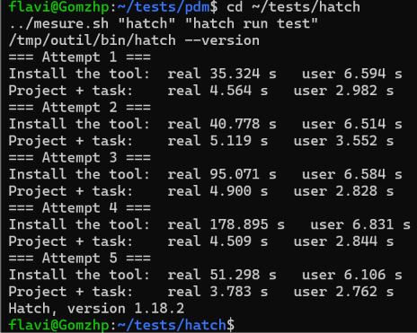
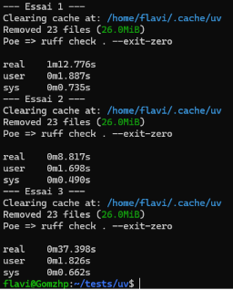
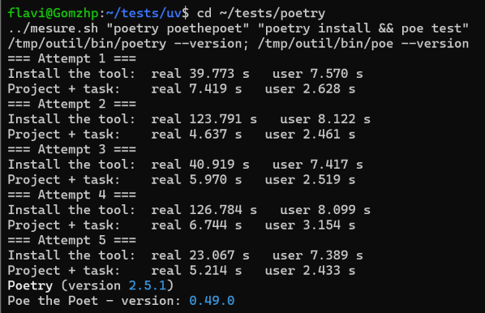

# Choosing a tool for dependencies and tasks

## 1. Goal

I am looking for a tool to manage the dependencies and the tasks (install, test, check...) of my Python 3.14 project. It has to follow the Python standards, so that I can switch tools later if needed.

## 2. Criteria

### Following the standard

- The Python standard for describing a project is the `pyproject.toml` file.
- Dependencies go in `[project]` (PEP 621) and development dependencies in `[dependency-groups]` (PEP 735).
	- https://packaging.python.org/en/latest/flow/
	- https://packaging.python.org/en/latest/guides/writing-pyproject-toml/

`requirements.txt` is not a standard, it is only a pip convention. For tasks there is no standard, each tool has its own way of doing it.

### Speed

I measure the time to install the tool, and then the time to install the project and run a task.

This is the most important criterion for my project. According to the course guide, these tools will be used in objectives 5 and 6 (containers and continuous integration), where "installation and execution speed is essential". In those cases, everything is often reinstalled every time.

Also, my code has almost no dependencies, because it uses `sqlite3` and `csv`, which come with Python. That is why what matters most is the time to install the tool and run a task.

## 3. Tools studied

I took the list from the official Python guide: https://packaging.python.org/en/latest/tutorials/managing-dependencies/#other-tools-for-application-dependency-management

| Tool | Kept? | Reason | Source |
|---|---|---|---|
| pip | No | Installs packages, but manages neither the environment nor the tasks. | https://pip.pypa.io/en/stable/user_guide/ |
| pip-tools | No | Manages neither the environment nor the tasks, and its lockfile is a `requirements.txt`. | https://pip-tools.pypa.io/en/stable/ |
| Pipenv | No | Uses its own file, the `Pipfile`, which is not a standard. | https://pipenv.pypa.io/en/latest/pipfile.html |
| Poetry | Yes | Uses `pyproject.toml`. | https://python-poetry.org/docs/pyproject/ |
| PDM | Yes | Uses `pyproject.toml`. | https://pdm-project.org/latest/usage/dependency/ |
| Hatch | Yes | Uses `pyproject.toml`. | https://hatch.pypa.io/latest/config/environment/overview/ |
| uv | Yes | Uses `pyproject.toml`. | https://docs.astral.sh/uv/concepts/projects/dependencies/ |

PDM and Hatch can also run tasks. uv and Poetry cannot, so I added Poe the Poet for them (https://poethepoet.natn.io/), so that I can compare all four. I chose Poe the Poet because it works with both, and it was the first tool I found on the internet. I compare it with other task tools in part 7.


## 4. Test scenario

For each tool, I measure two times:
1. the time to install the tool with `pip install`;
2. the time to install the project and run the `test` task, which runs `pytest`:
	- 2.1 create the virtual environment (`.venv`);
	- 2.2 read the dependencies in `pyproject.toml`
	- 2.3 resolve the versions and write the lockfile (`uv.lock`, `pdm.lock`, ...);
	- 2.4 download and install the packages;
	- 2.5 run the `test` task.

Conditions:
- same computer, same network, all 4 tools on the same day;
- WSL (Ubuntu 26.04.1) with Python 3.14.4, because CI and containers will run on Linux;
- each tool starts from a copy of the project with the same `pyproject.toml`;
- I clear the caches before each attempt, so the times include the downloads;
- 5 attempts per measurement, I keep the average;
- the `time` command gives two times, and I record both: the real time (`real`) and the tool's computing time (`user`).
- the project has no code yet, so I use one minimal test, so that pytest really runs.

So that the 4 tools do the same work, I told them not to install the project as a package, because it is not one.

I use this script for all the measurements:
```bash
export PATH=/tmp/outil/bin:$PATH
export POETRY_VIRTUALENVS_IN_PROJECT=true
TIMEFORMAT='real %R s   user %U s'

for i in 1 2 3 4 5; do
  echo "=== Attempt $i ==="
  rm -rf ~/.cache ~/.local/share/hatch /tmp/outil .venv *.lock
  /usr/bin/python3 -m venv /tmp/outil

  echo -n "Install the tool:  "
  time pip install -q $1 > /dev/null 2>&1

  echo -n "Project + task:    "
  time bash -c "$2" > log.txt 2>&1
done
```

## 5. Results

Measurements from 18 November 2026, average of 5 attempts. Each cell shows `real` / `user` time, in seconds.

| Tool | Version | Install the tool | Install the project + run the task | Total |
|---|---|---|---|---|
| PDM | | / | / | / |
| Hatch | | / | / | / |
| uv + Poe the Poet | | / | / | / |
| Poetry + Poe the Poet | | / | / | / |

Screenshots of the measurements:

### 5.1 PDM


### 5.2 Hatch



### 5.3 uv + Poe the Poet



### 5.4 Poetry + Poe the Poet


