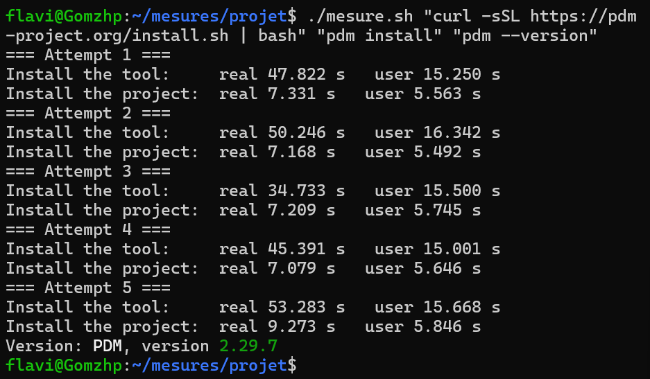
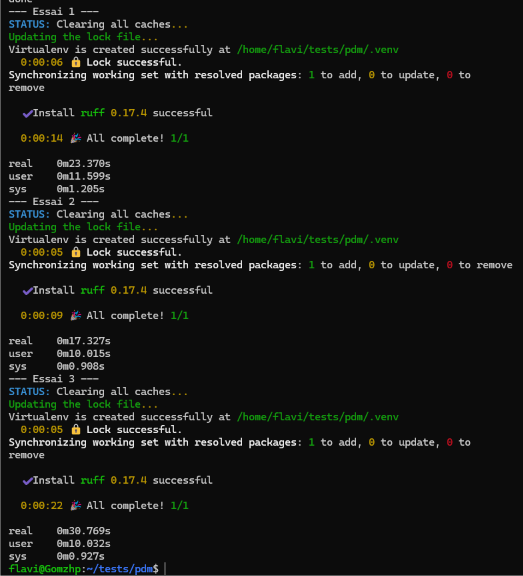
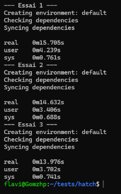
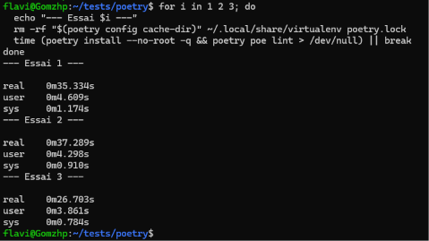
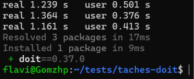
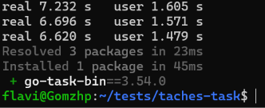
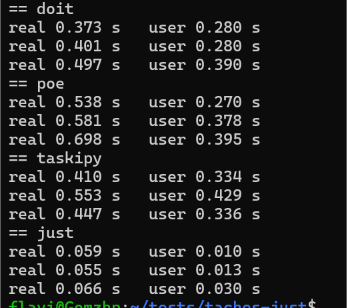

# Choosing a tool for dependencies and tasks

## 1. Goal

I am looking for a tool to manage the dependencies and the tasks (lint, test...) of my Python 3.14 project. It has to follow the Python standards, so that I can switch tools later if needed.

## 2. Criteria

### Following the standard

- The Python standard for describing a project is the `pyproject.toml` file.
- Dependencies go in `[project]` (PEP 621) and development dependencies in `[dependency-groups]` (PEP 735).
	- https://packaging.python.org/en/latest/flow/
	- https://packaging.python.org/en/latest/guides/writing-pyproject-toml/

`requirements.txt` is not a standard, it is only a pip convention. For tasks there is no standard, each tool has its own way of doing it.

### Speed

I measure the time to install the tool, and then the time to install the project and run a task.

This is the most important criterion for my project. According to the course guide, these tools will be used in objectives 5 and 6 (containers and continuous integration), where "installation and execution speed is essential". In those cases, everything is often reinstalled every time.

Also, my code has almost no dependencies, because it uses `sqlite3` and `csv`, which come with Python. Only the tasks need tools like ruff. That is why what matters most is the time to install the tool and run a task.

## 3. Tools studied

I took the list from the official Python guide: https://packaging.python.org/en/latest/tutorials/managing-dependencies/#other-tools-for-application-dependency-management

| Tool | Kept? | Reason | Source |
|---|---|---|---|
| pip | No | Installs packages, but manages neither the environment nor the tasks. | https://pip.pypa.io/en/stable/user_guide/ |
| pip-tools | No | Manages neither the environment nor the tasks, and its lockfile is a `requirements.txt`. | https://pip-tools.pypa.io/en/stable/ |
| Pipenv | No | Uses its own file, the `Pipfile`, which is not a standard. | https://pipenv.pypa.io/en/latest/pipfile.html |
| Poetry | Yes | Uses `pyproject.toml`. | https://python-poetry.org/docs/pyproject/ |
| PDM | Yes | Uses `pyproject.toml`. | https://pdm-project.org/latest/usage/dependency/ |
| Hatch | Yes | Uses `pyproject.toml`. | https://hatch.pypa.io/latest/config/environment/overview/ |
| uv | Yes | Uses `pyproject.toml`. | https://docs.astral.sh/uv/concepts/projects/dependencies/ |

PDM and Hatch can also run tasks. uv and Poetry cannot, so I added Poe the Poet for them (https://poethepoet.natn.io/).

## 4. Test scenario

For each tool, I measure two times:
1. the time to install the tool with `pip install`;
2. the time to install the project (with ruff) and run the `lint` task, which runs `ruff check .`.

Conditions:
- same computer, same network, all 4 tools on the same day;
- WSL (Ubuntu 26.04.1) with Python 3.14.4, because CI and containers will run on Linux;
- each tool starts from a copy of the project with the same `pyproject.toml`;
- I clear the caches before each attempt, so the times include the downloads;
- 3 attempts per measurement, I keep the average;
- the `time` command gives two times, and I record both: the real time (`real`) and the tool's computing time (`user`).

So that the 4 tools do the same work, I told them not to install the project as a package, because it is not one. With uv and Poetry, I also had to tell Poe where to find ruff.

## 5. Results

Measurements from 10 November 2026, average of 3 attempts.

| Tool | Version | Install the tool (s) | Run the task (s) | Total (s) |
| --------------------- | --------------- | --------------------- | ------------------- | --------- |
| PDM | 2.29.7 | 35.05 | 23.82 | 58.87 |
| Hatch | 1.18.2 | 117.04 | 14.77 | 131.81 |
| uv + Poe the Poet | 0.13.7 + 0.49.0 | 21.10 | 39.66 | 60.76 |
| Poetry + Poe the Poet | 2.5.1 + 0.49.0 | 131.29 | 33.11 | 164.40 |

The network changed a lot during the tests. For example, the task with uv took between 8.8 s and 72.8 s depending on the attempt. The `user` time, on the other hand, barely depends on the network, because it is the time the tool actually spends computing. Since the real times vary too much, I mostly rely on the `user` time to compare the tools.

| Tool | Install the tool, `user` (s) | Run the task, `user` (s) | Total `user` (s) |
|---|---|---|---|
| PDM | 10.07 | 10.55 | 20.62 |
| Hatch | 12.87 | 3.78 | 16.65 |
| uv + Poe the Poet | 2.86 | 1.80 | 4.66 |
| Poetry + Poe the Poet | 15.54 | 4.26 | 19.80 |

Screenshots of the measurements:

### 5.1 PDM

### 5.2 Hatch

### 5.3 uv + Poe the Poet

### 5.4 Poetry + Poe the Poet

## 6. Choice

I choose uv.

With the total time, uv + Poe (60.76 s) and PDM (58.87 s) are almost equal. The difference is 2 s, while the network made the same measurement vary between 8.8 s and 72.8 s depending on the attempt. So I cannot separate them with this time. Hatch and Poetry are slower.

With the `user` time, uv + Poe is the fastest: 4.66 s, while the others are between 16 and 21 s. This time barely depends on the network, so it is my most reliable measurement.

uv + Poe are two tools instead of one. But even as two, they install faster than PDM alone (21.10 s versus 35.05 s), and uv follows the standard, so I will be able to switch tools later if needed. I choose the task tool in part 8.

## 7. Task tool

In part 6 I chose Poe the Poet because it was the first task tool I found and because it worked with uv and with Poetry, without comparing it to the others.
Here I compare it with other tools.

uv does not manage tasks by itself (https://github.com/astral-sh/uv/issues/5903). That discussion mentions Poe the Poet, taskipy, just and doit. I added Task, which was another option I had considered.

Make is left out: my test measures the time to add the tool to the project with uv, and Make cannot be added that way because it is not a Python package (https://www.gnu.org/software/make/).

| Tool | Package | Source |
|---|---|---|
| Poe the Poet | `poethepoet` | https://poethepoet.natn.io/ |
| Taskipy | `taskipy` | https://pypi.org/project/taskipy/ |
| just | `rust-just` | https://pypi.org/project/rust-just/ |
| doit | `doit` | https://pydoit.org/ |
| Task | `go-task-bin` | https://taskfile.dev/installation/ |

### Test

I keep the same conditions as in part 4.

For each tool, I measure the time to add it to the project with uv, clearing the cache before each attempt.

For the 4 fastest tools, I also measure the time to run the `lint` task, which checks the code with ruff.

### Results

Measurements from 11 November 2026, average of 3 attempts.

| Tool | Version | Install, `user` (s) | Task, `user` (s) | Total `user` (s) |
|---|---|---|---|---|
| Poe the Poet | 0.49.0 | 0.61 | 0.35 | 0.96 |
| Taskipy | 1.14.1 | 0.64 | 0.37 | 1.01 |
| just | 1.59.0 | 0.64 | 0.02 | 0.66 |
| doit | 0.37.0 | 0.43 | 0.32 | 0.75 |
| Task | 3.54.0 | 1.55 | - | - |

## 8. Choosing the task tool

I choose just. It is the fastest in `user` time: 0.66 s in total, versus 0.75 s for doit, 0.96 s for Poe the Poet and 1.01 s for Taskipy. It takes a bit longer to install than doit, but it runs the task about 16 times faster (0.02 s versus 0.32 s).

My final choice is uv for dependencies and just for tasks.